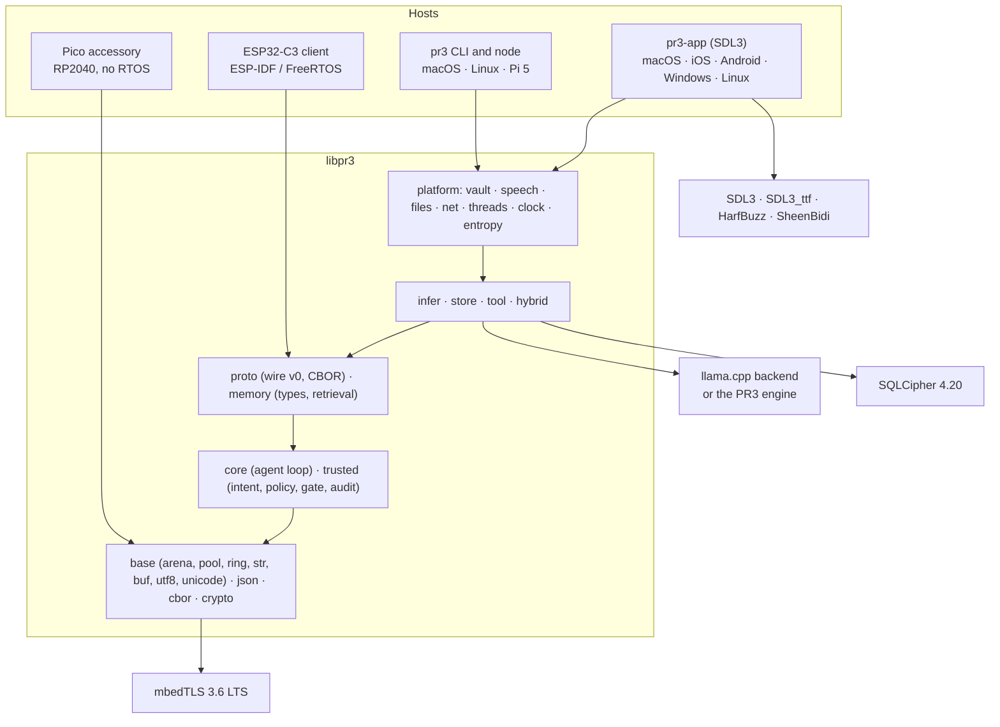
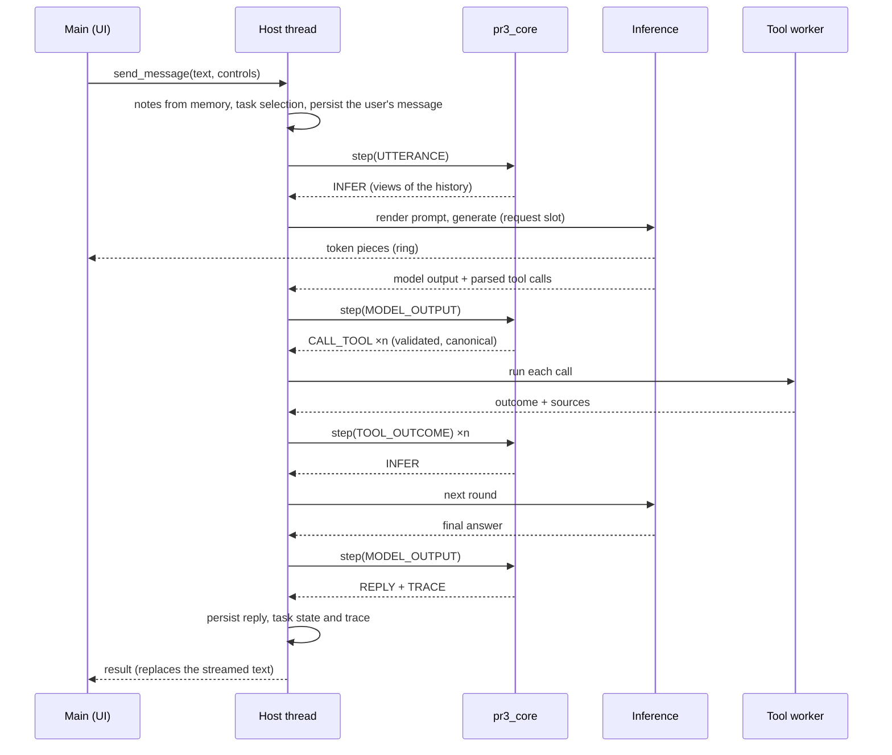

# System architecture

One C library, `libpr3`, built as a set of modules with a strict dependency order, and four kinds of host around it: the SDL3 app on phones and computers, the headless CLI and node on computers and the Raspberry Pi 5, the ESP32-C3 client firmware, and the Raspberry Pi Pico accessory firmware. The library at the centre is sans-I/O: the host owns the loop, the clock, entropy, threads, files and sockets, and feeds the core inputs; the core answers with actions ([part 04](04-core-runtime.md)). This split is what lets one core run from a microcontroller to a desktop ([D-01](19-decisions-and-risks.md)).

## Modules

| Module | Directory | Owns | Depends on | Heap | Profiles |
| --- | --- | --- | --- | --- | --- |
| `base` | `src/base/` | Status codes, arenas, pools, rings, slices and builders, checked arithmetic, UTF-8, Unicode property tables, SipHash | — | No | All |
| `json` | `src/json/` | Bounded tape parser; canonical writer ([D-08](19-decisions-and-risks.md)) | `base` | No | All but Pico |
| `cbor` | `src/cbor/` | Bounded CBOR decoder and canonical encoder ([D-09](19-decisions-and-risks.md)) | `base` | No | All |
| `crypto` | `src/crypto/` | Thin wrappers: SHA-256, HMAC, HKDF, P-256 verify, X25519, ChaCha20-Poly1305, BLAKE2s, SPAKE2; secret arena and wiping | `base`, mbedTLS, libsodium (pairing only) | No | All that verify approvals or pair |
| `core` | `src/core/` | The agent loop: sessions, turns, tool registry and schema subset, loop guard, traces | `base`, `json` | No | All but Pico |
| `trusted` | `src/trusted/` | Intents, policy, gate, receipts, capabilities, audit chain ([part 05](05-trusted-side.md)) | `base`, `json`, `crypto` only | No | Phones, computers |
| `memory` | `src/memory/` | Memory types and provenance, retrieval terms and scoring, sentences, quote and evidence references | `base`, `crypto` | No | Phones, computers, Pi 5 |
| `proto` | `src/proto/` | Wire protocol v0 messages, framing, continuity pages ([part 09](09-protocol-and-hybrid.md)) | `base`, `cbor`, `core` types | No | All but Pico (Pico speaks the accessory protocol) |
| `infer` | `src/infer/` | Prompt formats, streaming text pipeline, tool-call parsers, KV reuse and checkpoints, evidence fitting, report grammar; the llama.cpp backend and the PR3 engine ([part 06](06-inference.md)) | `base`, `json`, `memory`, llama.cpp or `engine` | Only inside llama.cpp | Phones, computers, Pi 5 |
| `engine` | `src/engine/` | PR3-owned GGUF loader, tokenizer, CPU kernels, Qwen3/Qwen3.5 execution, Metal and Vulkan paths | `base` | No (mapped weights, arenas) | Phones, computers, Pi 5 |
| `store` | `src/store/` | SQLCipher stores: memories, tasks, documents, research evidence, continuity, settings ([part 07](07-memory-and-storage.md)) | `base`, `json`, `memory`, `proto`, SQLCipher | Inside SQLCipher, from a PR3 heap region | Phones, computers, Pi 5 |
| `tool` | `src/tool/` | Calculator, clock, documents, memory tools, web reader, research ([part 08](08-tools-and-research.md)) | `base`, `json`, `memory`, `store` | No | Phones, computers, Pi 5 |
| `hybrid` | `src/hybrid/` | Pairing, Noise sessions, node and client ([part 09](09-protocol-and-hybrid.md)) | `base`, `cbor`, `crypto`, `proto` | No | Phones, computers, Pi 5, ESP32-C3 |
| `platform` | `src/platform/` | One interface, one implementation per OS: clock, entropy, files, sockets, threads, vault, storage key custody, speech, network state, share and save ([part 10](10-app-sdl3.md)) | `base`; OS APIs; Swift and Java bridges | Allowed | Per OS |
| `ui` | `app/pr3-app/ui/` | PR3's immediate-mode widget layer on SDL3 ([part 10](10-app-sdl3.md)) | `base`, SDL3, SDL3_ttf, HarfBuzz, SheenBidi | Allowed at the edges | Graphical builds only |

**Dependency rule.** A module may include only the headers of modules below it in the table's order, and `trusted` may include only `base`, `json` and `crypto`, never `core`, so it can move behind a protected boundary (a separate process, a secure element) later without an API change. `tools/check-layers.sh` checks every `#include` against this order in CI.

## Hosts

| Host | Directory | Runs | Links |
| --- | --- | --- | --- |
| `pr3-app` | `app/pr3-app/` | The graphical app on macOS, iOS, Android, Windows and Linux: chat, tasks, documents, memory, research, settings, devices, models, speech ([part 10](10-app-sdl3.md)) | Everything but `engine` until M6 |
| `pr3` | `app/pr3-cli/` | The headless CLI: chat with streaming and cancel, document import and search, fixture replay, the node (`pr3 node`), benchmarks | Everything but `ui` |
| ESP32-C3 client | `board/esp32c3/` | Pairs with a node over Wi-Fi, asks bounded questions, streams and cancels ([part 11](11-embedded-profiles.md)) | `base`, `cbor`, `crypto`, `proto`, `hybrid` (client half) |
| Pico accessory | `board/pico/` | Local status offline; questions through a serial gateway ([part 11](11-embedded-profiles.md)) | `base` and the accessory protocol |

## Threads

The portable libraries are single-threaded; threads belong to the host. The graphical app and the CLI use the same arrangement:

| Thread | Owns | Talks to the others through |
| --- | --- | --- |
| Main (SDL) | The window, input, IME, rendering, the UI state | SDL user events (woken), rings of `pr3_app_event` (read each frame) |
| Host | The `pr3_core`, the trusted gate, the stores, the tool registry, the task list | A command ring from the UI; an event ring to the UI; one request slot per worker |
| Inference | The model and its context (llama.cpp or the PR3 engine), the KV cache and checkpoints | A request slot from the host; a token ring to the UI (pieces of at most 64 bytes, back-pressured); a cancel flag (`_Atomic bool`, release/acquire) |
| I/O workers (2) | Web fetches, model downloads, node connections, exports | Request and result slots; a cancel flag per job |
| Speech | The platform recognizer and synthesizer | An event ring |

Only the host thread mutates PR3 state, so the core, the gate and the stores need no locks. Tokens go from the inference thread to the UI directly, without passing through the host, because the stream is display-only: the final `REPLY` action is what is stored and what replaces the streamed text.

## A turn

Cancellation: the UI sets the task's cancel flag; the host checks it before each `INFER`, `CALL_TOOL` or `PROPOSE` and after inference; the inference thread checks it per token and per read-ahead batch; a cancelled turn ends with the core's stopped text through `PR3_INPUT_ABORT`, so the session can take the next message.

## A consequential action

The full approval path is built and tested from the start: validated intent, policy, an approval card, the user's signature from the device vault (biometric where the OS offers it), a one-use capability and the audit entry ([part 05](05-trusted-side.md)). `PR3_ACTION_PROPOSE` reaches the gate in every build. The first operation is sending an email, and the first release ships no mail connector: a redeemed capability goes to a stub that answers "This action connector is not available." and the audit records it as not delivered. The benchmark build (`PR3_BENCH_MAIL`) adds a sandbox mail connector for the AgentDojo security suite ([part 15](15-benchmarks.md)).

## A paired request

A phone paired with a computer sends `generate` over a Noise IK session and receives `token` and `done` frames; tools, memory, approvals and keys stay on the phone, and the node can only propose ([part 09](09-protocol-and-hybrid.md)). If the node is unreachable for any reason other than a cancel, the phone answers with its own model.

## Trust boundaries

| Boundary | Untrusted side | Enforcement |
| --- | --- | --- |
| Model output → core | Everything the model writes | Tool-call parsers bound and canonicalize; the core validates names and arguments against the registered schema subset, limits rounds, calls and repeats ([part 04](04-core-runtime.md)) |
| Tool result → core | Web pages, research sources, documents | Results are clipped; untrusted-output tools block consequential calls for the rest of the turn; sources are host-supplied labels, never parsed from the text |
| Core → trusted side | `PROPOSE` actions | Envelope from host identity, clock and entropy; validator, policy, approval, receipt signature, capability, audit ([part 05](05-trusted-side.md)) |
| Peer → phone | A node's replies | Noise IK with a pinned static key; replies are proposals the phone's core validates |
| Phone → node | A paired phone's requests | Pairing allowlist, re-checked per request; one request per session; 1 MiB message ceiling |
| Network → web reader | HTTPS responses | HTTPS only, public addresses only on every hop, 2 MiB, 20 s, 5 redirects; bounded HTML parsing ([part 08](08-tools-and-research.md)) |
| Disk → stores | Database files, model files, configuration | SQLCipher with integrity checks; GGUF checked against its declared sizes; configuration read by a bounded subset parser |
| Accessory → gateway | Serial bytes from a Pico | Bounded framing, a read-only request class, the gateway owns credentials ([part 11](11-embedded-profiles.md)) |

## Profiles

| Profile | Modules linked | Third-party code linked |
| --- | --- | --- |
| Pico accessory | `base`, accessory protocol | Pico SDK |
| ESP32-C3 client | `base`, `cbor`, `crypto`, `proto`, `hybrid` client | ESP-IDF, mbedTLS (from ESP-IDF), libsodium core (pairing) |
| Headless node (Pi 5, computers) | All but `ui` | llama.cpp or the PR3 engine, SQLCipher, mbedTLS, libsodium, libcurl |
| Graphical app | All | The node's, plus SDL3, SDL3_ttf, HarfBuzz, FreeType, SheenBidi |

`tools/check-profile.sh` reads each artifact's link map and fails if a profile links a module or library outside its row ([ENG-10](17-delivery-plan.md)).

---

[Back to the index](../README.md)
