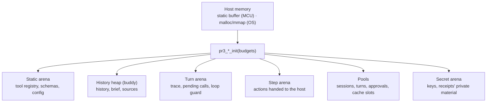

# Memory safety and the allocation model

How PR3 writes C that is memory-safe without paying for safety at run time. The usual price of safety is allocations and copies: a fresh copy of the conversation for every model step, a heap string per identifier, a JSON tree per argument check, a value tree per trace step. PR3 gets its guarantees from a small set of rules that the compiler, the sanitizers, the fuzzers and a bounded model checker can enforce, and from a memory model in which most allocations are a pointer bump into memory the host handed over at startup ([D-03](19-decisions-and-risks.md)).

The rules here bind every file under `src/`. The app (`app/`) and the platform adapters (`src/platform/`) follow them too, with the exceptions listed in [Where the heap is allowed](#where-the-heap-is-allowed).

## The contract

| Bug class | How PR3 excludes it | What proves it |
| --- | --- | --- |
| Out-of-bounds read or write | Every buffer travels as a pointer and a length (`pr3_str`, `pr3_bytes`, `PR3_VEC`); indexing an untrusted position goes through a checked accessor; flexible arrays carry `counted_by` | ASan and `-fsanitize=bounds` on every test and fuzz run; CBMC proofs for the containers and parsers |
| Use after free, double free | No `free` in the portable libraries: memory dies only when its arena is reset, at a lifetime boundary the API names. Long-lived objects live in pools behind generational handles, so a stale handle is a lookup failure, not a dangling pointer | ASan with manual arena poisoning: a reset arena is poisoned, so a use after reset is reported like a use after free; pool tests with stale handles |
| Leaks | Nothing to leak: arenas are reset wholesale; the high-water mark of each arena is reported and tested against its budget | Budget assertions in tests; `pr3_core_memory()` reports |
| Integer overflow in sizes | Every size computed from input goes through `pr3_ckd_add`/`pr3_ckd_mul` (C23 `<stdckdint.h>` or the compiler builtins) and fails with a status | UBSan (`signed-integer-overflow`, `unsigned-integer-overflow` in tests, `shift`, `implicit-conversion`); `-Wconversion -Wsign-conversion` as errors |
| Uninitialized reads | Designated initializers for every struct; `-ftrivial-auto-var-init=pattern` in debug and fuzz builds, `zero` in release | MSan on Linux CI; `-Wuninitialized` as an error |
| Invalid UTF-8 reaching text APIs | UTF-8 is validated once at each boundary ([Untrusted boundaries](#untrusted-boundaries)); a validated slice is a `pr3_str`, raw bytes are `pr3_bytes`, and the two do not convert implicitly | Fuzzers assert that every `pr3_str` they see is valid |
| Unbounded growth | Every container has a capacity fixed when its arena is sized; every parser has a byte, depth and count limit; recursion is banned in parsers | Limits tests; fuzzers run with a small arena so exhaustion paths are exercised |
| Data races | The portable libraries are single-threaded. Threads meet only at single-producer single-consumer rings that transfer ownership of fixed slots | TSan on the host tests |
| Panics on bad input | Input errors are statuses. `PR3_CHECK` traps only on a broken internal invariant, never on input; a fuzzer that reaches a trap has found a bug | Fuzzing; the trap sites are listed by `tools/check-traps.sh` |
| Secrets left in memory | Keys live only in a secret arena that is wiped with `pr3_wipe` (`memset_explicit`/`explicit_bzero`/`SecureZeroMemory`) on reset and is locked against swapping where the OS allows | Tests read the arena after reset |

**What C does not give.** The compiler does not prove lifetimes. PR3 narrows the problem instead of pretending it away: there are only four lifetimes ([below](#lifetimes)), every pointer the API returns names the lifetime it borrows from, and a debug build turns a violation into an ASan report on the first run that touches it. That is weaker than a proof and stronger than discipline alone, and it is why the trusted side additionally gets CBMC and Frama-C proofs before release ([REL-01](17-delivery-plan.md)).

## The memory model



The host decides where memory comes from; the libraries decide nothing. A microcontroller passes a static array. A desktop passes one `malloc` (or `mmap` with guard pages) sized from the configuration. `pr3_core_size(&config)` returns the exact byte count a configuration needs, computed from its limits with checked arithmetic, so a host can reject a configuration before allocating anything, and the whole core's memory is known before the first message.

### Arenas

`pr3_arena` is a bump allocator over one contiguous block:

```c
typedef struct pr3_arena {
    uint8_t *base;        /* first byte of the block */
    size_t   cap;         /* bytes in the block */
    size_t   used;        /* bytes handed out, including alignment padding */
    size_t   high_water;  /* largest `used` ever seen, for budgets */
    const char *name;     /* for diagnostics and budget reports */
} pr3_arena;

void  pr3_arena_init(pr3_arena *a, void *mem, size_t cap, const char *name);
void *pr3_arena_alloc(pr3_arena *a, size_t size, size_t align);          /* NULL when full */
void *pr3_arena_alloc_n(pr3_arena *a, size_t n, size_t size, size_t align); /* overflow-checked */
pr3_arena_mark pr3_arena_mark_get(const pr3_arena *a);
void  pr3_arena_rewind(pr3_arena *a, pr3_arena_mark m);  /* free everything after m */
void  pr3_arena_reset(pr3_arena *a);                     /* free everything */

#define PR3_NEW(a, T)      ((T *)pr3_arena_alloc((a), sizeof(T), _Alignof(T)))
#define PR3_NEW_N(a, T, n) ((T *)pr3_arena_alloc_n((a), (n), sizeof(T), _Alignof(T)))
```

- **Fast path.** Allocation is an align-up, a checked add and a compare: inlined, branch-predicted, no locks, no headers, no free lists. Releasing memory is one store.
- **Exhaustion is a value.** A full arena returns `NULL`; the caller returns `PR3_E_NOMEM` and the state machine is unchanged, because mutations happen after every allocation they need has succeeded ([Errors](#errors-and-transactions)).
- **Poisoning.** In ASan builds `rewind` and `reset` poison the released range (`ASAN_POISON_MEMORY_REGION`) and `alloc` unpoisons what it hands out, with a poisoned red zone between allocations. A pointer kept past its arena's reset is reported exactly as a use after free would be. Debug builds without ASan fill released memory with `0xDD` so stale reads are visible.
- **Budgets.** Every arena records its high-water mark. Tests assert that the worst case each limit allows fits the arena sized from that limit, so the sizing formula and the code cannot drift apart.

### Lifetimes

There are four, and every pointer the public API returns borrows from exactly one of them:

| Lifetime | Arena | Holds | Ends |
| --- | --- | --- | --- |
| Static | `static` | Tool registry, parsed schemas, configuration, Unicode tables (which are `const` data) | `pr3_core_destroy` |
| Session | The history heap (`pr3_buddy`) | A session's messages, brief, untrusted-source labels | The exchange is trimmed, `pr3_core_forget`, or the idle session is evicted |
| Turn | `turn` | The turn's trace steps, pending calls, the loop guard's seen set | The next call that changes the core after the turn's `REPLY` or `FAILED` |
| Step | `step` | The actions one `pr3_core_step` returns, and their payloads | The next call that changes the core: a step, a registration, `forget`, `set_brief` or `restore` |

The step lifetime is what removes copies. `PR3_ACTION_INFER` holds an array of `pr3_message`s whose text points into the history heap, valid until the host's next call that changes the core. When the request adds to the history (the brief on the first user message, the execution-budget message), the step arena holds a copy of the array and the one joined message, never the rest of the text. A host that needs the data longer copies it; the common host, which renders the prompt immediately, copies nothing.

**Session history without fragmentation.** History is the one place where sizes vary and lifetimes do not nest: an exchange dies when it is trimmed, and sessions die independently. Reserving every session's worst case would cost megabytes per idle session, so histories share one **buddy heap** (`pr3_buddy`): a power-of-two region split into blocks of 2^k bytes, split on allocation and coalesced with their buddy on release, O(log n) both ways, no external fragmentation that can lock memory into one size, and a high-water mark like an arena's ([part 04](04-core-runtime.md#the-history-heap)). A full heap is `PR3_E_NOMEM`, the same contract as an arena.

### Pools and handles

`pr3_pool` holds fixed-size slots for objects whose lifetimes do not nest: sessions, turns, waiting approvals, issued capabilities, KV checkpoints, cache entries.

```c
typedef struct pr3_handle { uint32_t index; uint32_t gen; } pr3_handle; /* gen 0 is the null handle */

pr3_status pr3_pool_init(pr3_pool *p, pr3_arena *from, size_t slot_size, size_t align, uint32_t cap);
void      *pr3_pool_acquire(pr3_pool *p, pr3_handle *out);   /* NULL when full */
void      *pr3_pool_get(const pr3_pool *p, pr3_handle h);    /* NULL when stale */
pr3_status pr3_pool_release(pr3_pool *p, pr3_handle h);      /* PR3_E_STATE when stale */
```

A slot's generation increments on release, so a handle kept after its object was released no longer resolves: the use-after-free becomes `NULL` and a status the caller must handle. Released slots are poisoned in ASan builds. The free list is an index array, so acquiring and releasing are O(1) and touch one cache line.

### Rings

Threads exchange work through `pr3_ring`: a single-producer single-consumer ring of fixed slots, power-of-two capacity, C11 `_Atomic` head and tail with acquire/release ordering and no locks. A slot belongs to the producer until it is published and to the consumer until it is consumed, so ownership crosses threads without sharing. The inference thread streams tokens to the UI this way ([part 10](10-app-sdl3.md)); a full ring is back-pressure, not an allocation.

### Containers

| Need | PR3 |
| --- | --- |
| Growable list | `PR3_VEC(T)`: `{T *items; uint32_t len, cap;}` with its capacity reserved from an arena; `pr3_vec_push` fails with `PR3_E_LIMIT` at capacity |
| Ordered map | A sorted array with binary search for the small maps of the core (at most a few dozen entries), which is faster than a tree at that size and has no allocation per insert; keys are integers wherever PR3 generates the key itself |
| Set of seen keys | A sorted array of 64-bit hashes plus the stored key for confirmation, or of integer ids |
| Hash table | Open addressing with a fixed capacity and a keyed hash (SipHash-1-3 with a host-supplied key) where a set may grow large; deterministic iteration is never taken from a hash table |
| String | `pr3_str` (a borrowed, validated UTF-8 slice) or a `pr3_buf` being built |

Integer ids replace generated strings: tool calls are named `call-1`, `call-2`, … in everything the model, the trace and the vectors see; the core keeps a `uint64_t` and writes `call-N` only when serializing.

### Strings and builders

```c
typedef struct pr3_str   { const char *ptr; size_t len; } pr3_str;     /* valid UTF-8 */
typedef struct pr3_bytes { const uint8_t *ptr; size_t len; } pr3_bytes; /* anything */
#define PR3_S(lit) ((pr3_str){ "" lit, sizeof(lit) - 1 })

typedef struct pr3_buf { char *ptr; size_t len; size_t cap; bool overflow; } pr3_buf;
void pr3_buf_put(pr3_buf *b, pr3_str s);
void pr3_buf_put_u64(pr3_buf *b, uint64_t v);
pr3_status pr3_buf_take(pr3_buf *b, pr3_str *out);  /* PR3_E_LIMIT if anything did not fit */
```

- Nothing depends on a terminating NUL. Slices carry their length, so a NUL inside model output is just a byte, and substring operations are pointer arithmetic, not copies.
- **Sticky overflow.** A builder that runs out of room sets `overflow` and ignores further writes; the caller checks once, at `pr3_buf_take`. Building a long message is a straight line of appends with no error branch after each, which is both faster and harder to get wrong than checking every call.
- Truncation on a character boundary, with the `" …[truncated]"` marker, is one function, `pr3_str_clip`, used everywhere text is clipped.
- Formatting never uses `printf` in the portable libraries: `pr3_buf_put_u64`, `pr3_buf_put_i64`, `pr3_buf_put_hex` and the JSON writer cover every case, with no format strings to get wrong.
- **Writers keep the builder in registers.** A `char` store may alias any object whose address has left the function, so a writer appending many small pieces through a caller's `pr3_buf *` reloads `len`, `cap` and `overflow` after every byte. The trace and canonical JSON writers instead work on a local copy, taken field by field, whose address never leaves the file. They write back `len` and `overflow` at the end. Every helper they call is inline, and an out-of-line call gets its own copy. This made the trace export about three times faster. The rules it rests on are listed in [Invariants the compiler does not check](#invariants-the-compiler-does-not-check).

## Bounds and arithmetic

- Sizes are `size_t`, counts that fit a slot are `uint32_t` with an explicit range check where they are narrowed. `-Wconversion -Wsign-conversion` are errors, so every narrowing is written out.
- `pr3_ckd_add(size_t *r, size_t a, size_t b)` and `pr3_ckd_mul` return `true` on overflow. They are `<stdckdint.h>` where the compiler has it, `__builtin_*_overflow` otherwise, and portable code on MSVC.
- An index that comes from input is checked against the length it indexes before use; an index the code computed itself is checked by `PR3_DEBUG_ASSERT` in debug builds and by `-fsanitize=bounds` in sanitizer builds.
- Structures with a trailing array declare it `PR3_COUNTED_BY(len)` (Clang's and GCC's `counted_by`), so `__builtin_dynamic_object_size` and the bounds sanitizer know the real size.
- Shifts are by unsigned amounts below the width; signed arithmetic is used only for values that are signed by meaning (times differences, scores) and checked where input reaches it.

## Errors and transactions

```c
typedef enum pr3_status {
    PR3_OK = 0,
    PR3_E_NOMEM,      /* an arena or pool is full */
    PR3_E_LIMIT,      /* input exceeds a configured limit */
    PR3_E_INVALID,    /* malformed input */
    PR3_E_UTF8,       /* invalid UTF-8 */
    PR3_E_STATE,      /* not allowed now (a turn in progress, a stale handle) */
    PR3_E_NOT_FOUND,
    PR3_E_IO,
    PR3_E_CRYPTO,
    PR3_E_CANCELLED,
} pr3_status;
```

- Every fallible function returns `pr3_status` and is declared `PR3_NODISCARD`; ignoring a status is a compile error.
- Out-parameters are written only on success.
- **Check, then commit.** A function that mutates state first reserves everything it needs (arena space, pool slots, capacity in containers) and validates everything it reads, then mutates with operations that cannot fail. A `PR3_E_NOMEM` therefore leaves the core exactly as it was. Where a mutation cannot be split this way, the function takes an arena mark and rewinds on failure.
- Domain errors that carry data (an input too large, with its length and the limit; an unknown contact, with the names that are known) return the status plus a detail struct the caller passes in, from which one function writes the message text the model or the user sees.
- No `errno`, no `setjmp`/`longjmp`, no `abort` reachable from input.

## Undefined behaviour

| Rule | Why |
| --- | --- |
| No VLAs, no `alloca` (`-Wvla` is an error) | Unbounded stack use |
| No recursion in parsers or anything that walks input | Explicit stacks with a fixed depth limit instead |
| Type punning only through `memcpy` | Strict aliasing stays on for the optimizer |
| Unaligned loads only through `memcpy` or `pr3_load_le32`-style helpers | Alignment UB, and the helpers compile to single loads |
| No pointer arithmetic outside the object; no arithmetic on `NULL` | The containers and slices are the only places that offset pointers |
| No `restrict` in public APIs | An aliasing promise the caller cannot check |
| `static inline` helpers instead of function-like macros wherever a type is known | Single evaluation, type checking |
| Every `switch` on an enum lists every case and has no `default` (`-Wswitch-enum`) | A new enum value is a compile error at every use |
| `-fno-delete-null-pointer-checks` is not used; null checks are explicit and early | Pointers from the API are never null on success |

## Banned functions

`include/pr3/poison.h` is the last include of every file in the portable libraries and poisons, with `#pragma GCC poison`, every function the libraries must not call. Using one is a compile error, not a review comment:

| Banned | Use instead |
| --- | --- |
| `malloc`, `calloc`, `realloc`, `free`, `strdup`, `strndup`, `aligned_alloc` | Arenas and pools |
| `strcpy`, `strcat`, `strncpy`, `strncat`, `sprintf`, `vsprintf`, `snprintf`, `vsnprintf`, `gets`, `strtok` | `pr3_buf`, `pr3_str` |
| `strlen` on anything not a literal, `strcmp`, `strncmp`, `atoi`, `atol`, `strtol`, `strtoul`, `strtod`, `sscanf` | `pr3_str_eq`, `pr3_parse_u64`, the JSON number parser |
| `printf` family, `puts`, `fopen` | The host's log and file callbacks |
| `rand`, `srand`, `time`, `clock` | The host's entropy and clock |
| `setjmp`, `longjmp`, `signal`, `exit`, `abort` | Statuses; `PR3_CHECK` for invariants |

`memcpy`, `memmove`, `memset`, `memcmp` and `memchr` stay: they take lengths and are what the compiler turns loops into anyway. `tools/check-banned.sh` repeats the check over `src/` for code that slips past the include.

## Where the heap is allowed

- The host's top-level allocation of arenas (`app/`, `src/platform/`, test drivers).
- Inside third-party libraries PR3 links but does not own: llama.cpp, SQLCipher, mbedTLS, SDL3, HarfBuzz. Their memory is measured as part of the process and reported beside the PR3 arenas ([part 15](15-benchmarks.md)); SQLCipher and mbedTLS are configured to allocate from PR3-provided pools where their configuration allows it (`SQLITE_CONFIG_HEAP`, `MBEDTLS_MEMORY_BUFFER_ALLOC_C`).
- The PR3-owned inference engine ([part 06](06-inference.md)) does not use the heap: weights are mapped, and activations, KV cache and scratch come from arenas sized from the model's header.

## Untrusted boundaries

Every byte that crosses one of these enters through a bounded parser and leaves as validated, typed data in an arena:

| Boundary | Parser | Limits (all in `pr3/limits.h`) |
| --- | --- | --- |
| User text | `pr3_utf8_validate` | `max_input_bytes` 16 KiB |
| Model output: content and tool calls | Think filter, tool-block extractor, Hermes and XML call parsers ([part 06](06-inference.md)) | `max_input_bytes`, 4 calls per round, 4 KiB arguments |
| Tool arguments and results | `pr3_json` tape parser, schema checker | 4 KiB arguments, 8 KiB output, depth 127 |
| Protocol frames | `pr3_cbor` decoder | 1 MiB per message, depth 32, item counts per message type |
| Web pages | Bounded HTML tokenizer and tree ([part 08](08-tools-and-research.md)) | 2 MiB body, 512 open elements |
| Documents | UTF-8 validation, line splitter | 512 KiB per document, 16 MiB per library |
| GGUF files | `pr3_gguf` header and tensor table reader ([part 06](06-inference.md)) | Every offset and size checked against the mapped file |
| Configuration | Bounded TOML subset reader | 64 KiB, the keys PR3 reads |
| Stored rows | Re-validated on read like any other input | Same as when written |

## Verification

| Layer | Tool | Runs |
| --- | --- | --- |
| Compiler | Clang and GCC with `-Wall -Wextra -Wpedantic -Wconversion -Wsign-conversion -Wshadow -Wcast-qual -Wcast-align -Wvla -Wswitch-enum -Wimplicit-fallthrough -Wstrict-prototypes -Wmissing-prototypes -Wnull-dereference -Wformat=2 -Wundef -Werror`; MSVC `/W4 /WX /sdl` | Every build |
| Static analysis | Clang static analyzer, `clang-tidy` (`bugprone-*`, `cert-*`, `clang-analyzer-*`, `misc-*`), GCC `-fanalyzer` | Every pull request |
| Sanitizers | ASan + UBSan (with arena poisoning), MSan (Linux), TSan (host threads) | Every pull request, every test |
| Fuzzing | libFuzzer target per parser with a seed corpus and a dictionary; arenas sized small so exhaustion paths run | Short runs per pull request, long runs nightly ([part 14](14-build-and-quality.md)) |
| Golden vectors | Inputs and expected bytes for every format PR3 writes, checked in under `test/vectors/` ([D-15](19-decisions-and-risks.md)) | Every test run |
| Bounded model checking | CBMC on the arena, pool, buddy heap, ring, builder, UTF-8 and JSON number code (`test/cbmc/`, `tools/run-cbmc.sh`) | Before M1 closes, then nightly |
| Deductive proof | Frama-C WP on the trusted side's validator, policy and audit chain | Before release ([REL-01](17-delivery-plan.md)) |
| Release hardening | `-D_FORTIFY_SOURCE=3`, `-fstack-protector-strong`, `-fstack-clash-protection`, `-fcf-protection=full` (x86-64), `-mbranch-protection=standard` (AArch64), PIE, full RELRO, `-ftrivial-auto-var-init=zero` | Every release build |

## Why it is faster

| Where runtimes usually spend | What PR3 does instead |
| --- | --- |
| A copy of the whole conversation for every model step | `PR3_ACTION_INFER` borrows views into the session's memory: no copy |
| Formatted string ids (`call-N`) as keys in tree maps | `uint64_t` ids in sorted arrays inside the turn arena |
| Parsing arguments into a value tree, then printing the tree to canonicalize | One pass over a tape of tokens in the step arena; canonical output written straight from the tape |
| Trace steps built as value trees during the turn | Compact step records; JSON written only when the host exports the trace |
| A new `name|arguments` string per call for loop detection | A 64-bit hash of the canonical bytes, with the bytes compared on a hash match |
| A string per token, then filter stages that each build a new string and re-scan it | One fixed token buffer and streaming state machines that scan each byte once ([part 06](06-inference.md)) |
| A WebView and a JavaScript UI | An SDL3 window and an immediate-mode UI ([part 10](10-app-sdl3.md)) |

Rules that keep it fast: no allocation inside a loop that runs per token or per byte; the arena fast path is inlined; hot structures are laid out by access (structure of arrays for token streams, tight `uint32_t` indices instead of pointers where the set is bounded); no lock on any path that runs per token; LTO for every release build, PGO once the benchmark workloads are frozen ([part 15](15-benchmarks.md)).

## Invariants the compiler does not check

The fast paths above rest on rules that hold only because the code keeps them. The compiler accepts a break in each, and most breaks pass every host test. Each row names what catches a break, and says so where nothing does. A change to the code named here is reviewed against this table, and a new rule of this kind is added to it.

| Rule | What a break does | What catches it |
| --- | --- | --- |
| **A writer that copies the builder writes it back on every exit.** `pr3_json_write` and `pr3_trace_write_json` work through a local `copy` and leave only through the write-back of `len` and `overflow` (the scalar path's, or the one at `done:`). Inside them every write goes through `out`, never `dst` | A `return` that skips the write-back loses everything written since the copy, with no error; a write through `dst` is overwritten by the write-back | The JSON writer's tests and `test_core_vectors_match`, on the paths they reach |
| **Helpers that take `out` are inline.** An out-of-line helper gets its own field-by-field copy and writes it back, as `pr3_json_put_f64` does in `put_scalar` and `pr3_json_put_string_tight` does in `pr3_json_put_string` | Passing `out` to an out-of-line call lets its address escape, and the compiler goes back to reloading the builder after every byte. The output is unchanged; the trace export is about three times slower | Only the plain and tool turns of `bench/c/bench_core.c`, against the [module budgets](15-benchmarks.md#module-budgets) |
| **The code the board images link calls no runtime helper outside its reviewed list.** Builders are copied field by field, `pr3_buf c = {b->ptr, b->len, b->cap, b->overflow}`, and written back the same way (`b->len = c.len; b->overflow = c.overflow;`), never `c = *b` or `*b = c`. Words move between two byte pointers through `pr3_load_le64` and `pr3_store_le64`, not `memcpy(p, q, 8)` | On armv6m, a whole-builder copy (which also copies the padding after `overflow`) and an 8-byte `memcpy` between unaligned pointers both become calls to `__aeabi_memcpy`, which the images do not provide | `freestanding.*.symbols` in the `armv6m` and `rv32imc` presets, against `board/freestanding/symbols-*.txt`; no host preset sees it. The images link base and json today, so core is not checked yet. A list is rewritten (`PR3_WRITE=1 tools/check-freestanding.sh`) only after its new symbols are reviewed |
| **Wrap-around on purpose is marked `PR3_WRAPPING`, and nothing else is.** The byte tests in `escape_flags`, SipHash and the ring's indices wrap by design. A marked function stays small and holds little but that arithmetic | Unmarked, the wrap traps in the `ubsan` preset and the tests abort. Marked too widely, a real overflow beside it goes unreported | The `ubsan` preset (`PR3_SANITIZE_OWN`) for a missing mark; review for a mark that covers too much |
| **`pr3_json_escape` gets six bytes of room per input byte.** It checks nothing, and one input byte can take six (`\u00XX`). Its 8-byte stores run ahead of the bytes it has finished, but never past the end of its result. `pr3_json_put_string` calls it only when `s.len <= (room - 2) / 6`, the 2 being the quotes; with less room it uses `pr3_json_put_string_tight`, which checks every byte | A write past the builder's capacity | `test_escapes_are_exact_at_every_offset_and_capacity`, which checks the result and the 16 bytes past the capacity at every offset and capacity |
| **`escape_flags` misses no byte that needs an escape, and its lowest flag is exact.** Flags above the lowest may be false, because a borrow runs upward, so the loop acts only on `pr3_ctz64(hit) / 8` and reads on from the byte after it | A missed byte leaves a raw control character, quote or backslash inside a JSON string | The escape test, whose random text mixes escapes, multibyte characters and letters at every alignment |
| **`pr3_ctz64` is never called with zero.** Callers test the word first, as the escaper does | `__builtin_ctzll(0)` is undefined, and the portable loop never ends | UBSan's `builtin` check, on the paths the tests reach |
| **A session's `head`, `msgs` and `meta` change together, and only in `drop_front`, `history_push` and `history_clear`.** Emptying a history goes through `history_clear`. Nothing keeps a pointer or an index into a session's records across a push; the views the host borrows (`PR3_ACTION_INFER`, `pr3_core_history`) are safe because only a call that ends them can push | `msgs` points `head` records past the session's first slot. Changing one of the three alone points the history at the wrong records, and past a session's last slot lie the next session's | `test_history_stays_in_order_across_many_trims`. ASan sees nothing: every session's slots are one allocation |
| **Trace keys are written in byte order by hand.** `pr3_trace_write_json` and `put_step` write each object's keys sorted, so the trace is canonical without sorting. A new field goes in at its sorted place, and only an object's first key passes `true` to `KEY` | A trace that is valid JSON but not canonical, or not JSON at all when a comma is missing or doubled | `test_random_steps_keep_the_core_consistent`, which checks that every trace it exports is already canonical, for the step types it reaches. `test_core_vectors_match` canonicalizes before it compares, so it does not catch this |

## Rules for reviewers

Each pull request is checked against this list; the [build and quality](14-build-and-quality.md) checks automate what they can.

1. Every new buffer is a slice with a length, or a builder with a capacity.
2. Every new allocation names its arena, and that arena's lifetime covers every use of the result.
3. Every function that can fail returns `pr3_status` and is `PR3_NODISCARD`; state is mutated only after the last fallible step.
4. Every size computed from input uses checked arithmetic.
5. Every loop over input has a bound that does not depend on the input being well formed.
6. No recursion over input; no VLAs.
7. Every limit is declared in `include/pr3/limits.h` with a comment saying why it has its value.
8. Every parser has a fuzz target and a corpus before it is merged.
9. Every text the model or the user sees lives in one place per module and is pinned by a golden vector, so a changed byte is a reviewed change ([test ledger](20-test-ledger.md)).
10. No secret outside the secret arena; wipe on every exit path.
11. A change to code named in [Invariants the compiler does not check](#invariants-the-compiler-does-not-check) keeps every rule there and passes the `ubsan` and `armv6m` presets and the core benchmark; a new rule of that kind is added to the table.

---

[Back to the index](../README.md)
