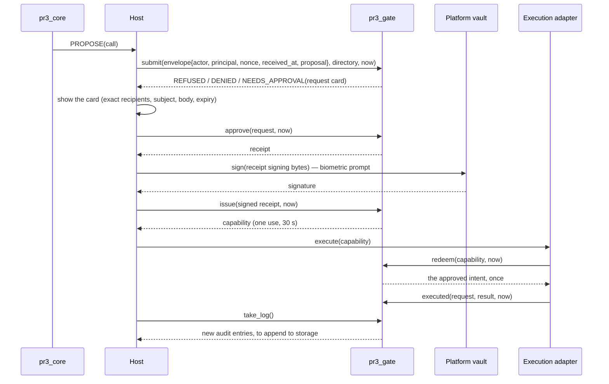

# Trusted side

The part of PR3 that decides whether something consequential happens: a structured intent, a deterministic policy, the user's approval signed by a device key, a one-use capability and a hash-chained audit log. Its formats are fixed byte for byte, because they outlive the build that wrote them: a receipt signed today must verify after an upgrade, and an audit log must resume on a new version and on a replacement device ([DATA-01](17-delivery-plan.md)).

## Isolation

`src/trusted/` includes `base`, `json` and `crypto` and nothing else: not `core`, not inference, not storage. It shares only `pr3_timestamp` with the agent loop, so the whole directory can move into a separate process, a protected VM or a microkernel domain without an API change (the `dev`, `protected` and `secure` tiers). `tools/check-layers.sh` enforces it.

Every function is sans-I/O: the host supplies the time, the envelope's nonce, the user's answer and the vault's signature, and stores the audit entries the gate hands back.

## The sequence

## Intents

`pr3_intent_validate(envelope, directory, replay_window, now)` checks, in order:

| Check | Value | Refusal text |
| --- | --- | --- |
| Not from the future | `received_at ≤ now + 2000 ms` | `the request is dated in the future` |
| Fresh | `now − received_at ≤ 30000 ms` | `the request is too old` |
| Nonce | 1–64 bytes of ASCII letters and digits | `the request has no valid nonce` |
| Replay | Nonce not seen within 30 s; admitted before the arguments are read, so a refused envelope is used up too | `the request was already submitted` |
| Operation | `mail.send` only | `unknown operation '<op>'` |
| Fields | Exactly `to`, `subject`, `body` | `unexpected argument '<name>'` |
| `to` | Contact names separated by commas, 1–10; an `@` means a typed address and is refused; a name resolves to exactly one contact by full name, else by first name (case and spacing ignored); duplicates collapse | `no contact named '<name>'` with the known names and a hint to add the contact in the Contacts app; `'<name>' matches more than one contact`; `type contact names, not addresses` |
| `subject` | Trimmed, 1–200 bytes, no control characters, nothing invisible | `the subject …` |
| `body` | Trimmed, 1–8192 bytes, no control characters but newline and tab, nothing invisible | `the body …` |

**Nothing hidden reaches the confirmation screen.** The validator refuses characters that show nothing: Unicode format characters (bidirectional controls among them), line and paragraph separators, variation selectors, tag characters, fillers that draw as blanks, private-use characters. The zero-width joiners pass only between letters they visibly shape (Arabic script, Indic scripts, emoji), and the emoji variation selector only after a symbol that has an emoji form. The code-point ranges live in `src/trusted/invisible.c`; text is decoded once, left to right, with one code point of look-ahead.

**Unicode operations.** The validator relies on four Unicode operations whose results reach the user or decide a match: trimming (`White_Space`), the control test (general category `Cc`), whitespace splitting, and lowercasing with full mappings (including `İ` → `i̇` and the final-sigma rule). Their tables are generated from the Unicode Character Database 17.0 by `tools/gen-unicode/`, checked in as generated files, and compared against the database over every code point in CI ([D-14](19-decisions-and-risks.md)).

Model text quoted back in a refusal is cleaned: control characters removed, at most 64 characters, `…` appended when the original had more than 64 characters counted before removal.

## Policy

`pr3_policy_decide(intent, limits, context)` applies these rules in order:

| Rule | Default | Result |
| --- | --- | --- |
| Kill switch off | `enabled = true` | Deny: `consequential actions are switched off` |
| Another approval is waiting | — | Deny: `another action is waiting for the user's approval` |
| Actions in the last 24 hours (issued, waiting and held) reach the limit | `max_per_day = 20` | Deny: `the limit of 20 actions a day is reached` |
| More recipients than allowed | `max_recipients = 3` | Deny: `at most 3 recipients per email` |
| Otherwise | — | Confirm, risk `high` with more than one recipient, else `low` |

Approval time `approval_ms = 120000`; capability lifetime `capability_ms = 30000`.

## The gate

`pr3_gate` holds its state in fixed capacity: the replay window (nonces seen in the last 30 s), waiting requests, issued capabilities, issue times in the last 24 hours (a ring of `max_per_day` + waiting entries), the chain head and the unsaved entries. Its operations and their audit events:

| Operation | Effect | Events appended |
| --- | --- | --- |
| `pr3_gate_open(limits, approval_key, provider, log, now)` | Verifies the stored log, resumes the chain, rebuilds the daily count from `issued` events; every request the log leaves waiting or holding an unused capability is expired at `now`; one left mid-delivery (redeemed, not executed) stays open | `expired` per request left open |
| `submit` | Expire late requests, validate, decide | `proposed`, then `refused`, `denied` or `awaiting_approval` |
| `approve` | Fix `approved_at` the first time, return the receipt (the same receipt if asked again) | — |
| `decline` | Drop the waiting request | `declined` |
| `issue` | The signed receipt must be exactly the one `approve` returned, for a request still waiting, with a valid signature; any failure ends the request | `approved` and `issued`, or `declined` with the reason |
| `redeem` | The capability must match the issued one exactly; it is used once | `redeemed`, or `declined` on mismatch |
| `executed` | Record the adapter's result, detail clipped to 256 characters | `executed` |
| `expire` | End approvals and capabilities past their time | `expired` |
| `take_log` | Hand the unsaved entries to the host | — |

Capacities: waiting requests, issued capabilities and replay nonces are bounded by the policy itself (one waiting approval at a time; 20 a day) and by the replay window, and the gate's memory is sized from them at init. Overflowing any of them is a refusal, never a silent drop.

## Byte formats

These formats are fixed byte for byte, and each has golden vectors under `test/vectors/trusted/` ([D-15](19-decisions-and-risks.md)).

**Hash.** `pr3_hash_of(parts)` is SHA-256 over each part prefixed with its length as an unsigned 64-bit big-endian integer. Written as 64 lowercase hex digits.

**Objects.** `{"kind":"mail","to":["<address>",…],"subject":"<hex of pr3_hash_of([subject])>","body":"<hex of pr3_hash_of([body])>"}`.

**Receipts.** The signed bytes are `pr3-approval-receipt-v1\n` followed by the receipt as compact JSON with fields in this order: `request`, `principal`, `actor`, `operation`, `provider`, `object`, `approved_at`, `expires_at`. Timestamps are JSON integers. Strings are escaped as in canonical JSON ([part 04](04-core-runtime.md#tool-registry-and-the-schema-subset)): `\"`, `\\`, `\b`, `\f`, `\n`, `\r`, `\t`, other bytes below `0x20` as `\u00xx` in lowercase hex, everything else, `/` and non-ASCII included, as is. The receipt hash is `pr3_hash_of([signing bytes])`.

**Signatures.** ECDSA P-256 with SHA-256 over the signing bytes. The signature arrives as hex of either DER (as Secure Enclave and Android Keystore return it) or 64 raw bytes `r‖s`. DER is parsed by PR3 strictly (a `SEQUENCE` of two `INTEGER`s, minimal integer encodings, definite short or long lengths that are exact, nothing trailing) and `r`, `s` must be in `[1, n−1]`; the verification itself is mbedTLS's `mbedtls_ecdsa_verify` on the parsed values ([D-07](19-decisions-and-risks.md)). The approval key is a SEC1 point, compressed or uncompressed.

**Audit entries.** `{seq, at, prev, event, hash}`, where `hash = pr3_hash_of(["pr3-audit-v1", seq as u64 BE, at as u64 BE, prev (32 bytes), event as JSON])` and the first entry's `prev` is 32 zero bytes. Events are tagged with `event` first, then their fields in declaration order:

| Event | Fields after `"event"` |
| --- | --- |
| `proposed` | `request`, `actor`, `principal`, `operation` |
| `refused` | `request`, `reason` |
| `denied` | `request`, `object`, `reason` |
| `awaiting_approval` | `request`, `object`, `risk` (`"low"` or `"high"`), `expires_at` |
| `approved` | `request`, `receipt` (hash hex) |
| `declined` | `request`, `reason` |
| `expired` | `request` |
| `issued` | `request`, `expires_at` |
| `redeemed` | `request` |
| `executed` | `request`, `success`, `detail` |

`pr3_audit_verify` walks a stored log and reports the first position that does not follow from the ones before it.

## Crypto

| Need | Implementation | Why |
| --- | --- | --- |
| SHA-256 | mbedTLS 3.6 LTS, with the ARMv8 and SHA-NI paths enabled | Reviewed, maintained, the library ESP-IDF and the Pico SDK already ship ([D-07](19-decisions-and-risks.md)) |
| P-256 ECDSA verify | mbedTLS, on signatures parsed by PR3 | As above; PR3's own DER parser fixes the strictness |
| Secret material | `pr3_secret` arena: locked pages where the OS allows, wiped with `pr3_wipe` on every exit path | Keys never outlive their use |

The trusted side never signs: signing happens inside the platform's key storage (Secure Enclave, Android Keystore with StrongBox where present, a guarded software key on the development tier), reached through `src/platform/` ([part 10](10-app-sdl3.md)).

## Tests

`test/unit/test_trusted.c`: `names_resolve_to_the_directorys_addresses`, `the_model_cannot_supply_addresses_identity_or_extra_fields`, `nothing_hidden_reaches_the_confirmation_screen`, `text_is_bounded_single_line_where_needed_and_never_reordered`, `envelopes_are_fresh_and_used_once`, `unknown_operations_are_refused`, `every_email_needs_approval_and_risk_grows_with_recipients`, `kill_switch_daily_limit_and_one_question_at_a_time`, `approved_mail_is_issued_redeemed_once_and_fully_audited`, `declined_refused_and_denied_requests_issue_nothing`, `approval_needs_an_approval_and_the_right_key`, `the_daily_limit_survives_a_restart`, `a_broken_log_is_refused`, `requests_left_open_when_the_app_closed_expire_when_it_opens`, `a_resumed_chain_continues_where_it_stopped`, `hex_round_trips_and_rejects_junk`, `parts_cannot_run_together`. Four are seeded randomized tests over many mutations: `any_rewrite_breaks_the_chain`, `tampered_receipts_never_issue`, `late_approvals_and_capabilities_never_authorize`, `altered_capabilities_are_refused`; in M7 they also become CBMC harnesses over the same mutations.

Compatibility across versions: the golden logs and receipts under `test/vectors/trusted/` must verify and resume on every later build; a change that breaks one is a format change and needs a new version tag (`pr3-audit-v2`, `pr3-approval-receipt-v2`) and a decision.

---

[Back to the index](../README.md)
