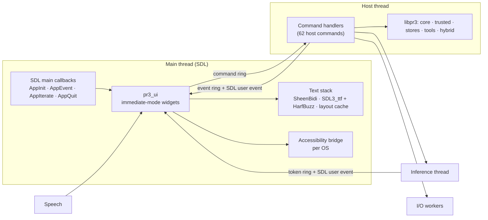

# The SDL3 app

`pr3-app` is one native C program on SDL3 for macOS, iOS, Android, Windows and Linux ([D-02](19-decisions-and-risks.md)). There is no WebView, no JavaScript runtime and no IPC between a UI process and a host: the UI, the host commands and the engine share one address space and talk through bounded rings. That is where the app's small idle memory and fast start-up come from ([part 15](15-benchmarks.md#app-targets)).

## Structure

- **SDL main callbacks** (`SDL_MAIN_USE_CALLBACKS`), the model SDL3 needs for iOS and Android lifecycles, on every platform. `SDL_HINT_MAIN_CALLBACK_RATE` is `waitevent`: the app draws only when something changed (input, a token, an animation in flight, a worker's event), so an idle app uses no CPU. Workers wake the main thread with `SDL_PushEvent` after writing to their ring.
- **Rendering** through `SDL_Renderer` (Metal on Apple, Direct3D 12/11 on Windows, Vulkan or OpenGL ES on Android and Linux): rounded rectangles and shadows as `SDL_RenderGeometry` triangle lists, text from glyph atlases, icons from a single texture atlas. `SDL_GPU` is kept for later effects, not needed for a 2D UI.
- **Lifecycle.** `SDL_EVENT_WILL_ENTER_BACKGROUND` saves state and pauses read-ahead; `SDL_EVENT_DID_ENTER_FOREGROUND` resumes; `SDL_EVENT_TERMINATING` and `SDL_AppQuit` stop inference, wait for the model's holders to release it (at most 10 s, because Metal aborts if buffers outlive the process) and close the stores.

## The UI layer

`pr3_ui` is a small immediate-mode layer written for this app, not a general toolkit ([D-10](19-decisions-and-risks.md)). Nuklear and Dear ImGui were considered and set aside: neither shapes complex scripts or lays out bidirectional text, and PR3's primary languages include Persian.

| Concern | Design |
| --- | --- |
| Frame | `ui_begin(frame_arena, input)` … widgets … `ui_end()` produces a draw list and an accessibility tree; the frame arena is reset each frame |
| Identity | Widget ids hashed from an id stack (`ui_push_id`), so lists keep state by item id, not position |
| Retained state | Scroll offsets, text-field contents and selections, animation clocks: a fixed-capacity table keyed by widget id, evicted when a widget is not seen for a few frames |
| Layout | Rows, columns and stacks with fixed, fit and fill sizes; safe areas from `SDL_GetWindowSafeArea`; sizes in points, scaled by `SDL_GetWindowDisplayScale` |
| Lists | Virtualized: only visible items are laid out; item heights cached by id and width, so a long chat scrolls without measuring every message |
| Widgets | Label, rich text (PR3's Markdown subset: paragraphs, emphasis, code spans and blocks, lists, links), button, icon button, toggle, select, text field (single and multi-line), scroll view with touch momentum and the "go to end" affordance, tabs, swipe pages, details/disclosure, dialog, menu, progress bar, banner, toast |
| Input | Mouse, touch and pen through SDL's unified events; keyboard navigation with focus order and visible focus; desktop shortcuts for send, stop and escape to cancel listening |
| Theme | Light and dark from `SDL_GetSystemTheme`, tokens in one table |

## Text

| Need | Implementation |
| --- | --- |
| Shaping | SDL3_ttf 3.x with HarfBuzz, per run, with the run's script and direction |
| Bidirectional text | SheenBidi (UAX #9): paragraph direction from the first strong character, visual runs per line |
| Line breaking | UAX #14 break opportunities, then greedy fitting per run |
| Fonts | Vazirmatn (Persian and Arabic) and Noto Sans (Latin, Greek, Cyrillic), bundled under the OFL; system emoji font as fallback; `TTF_AddFallbackFont` chains |
| Layout cache | Shaped and broken layouts cached by (text hash, width, style) in a fixed-capacity LRU; a streamed reply reshapes only its last paragraph per token |
| Editing | Selection, caret movement by grapheme cluster and word, copy, cut, paste (`SDL_SetClipboardText`), undo; mixed-direction carets follow the visual order |
| Input methods | `SDL_StartTextInputWithProperties` (multi-line, capitalization, autocorrect hints), `SDL_SetTextInputArea` at the caret for candidate windows, composition from `SDL_EVENT_TEXT_EDITING` shown underlined in place, commits from `SDL_EVENT_TEXT_INPUT`; the phone keyboard's insets move the composer |

Every string the UI shows lives in one table, `app/pr3-app/strings.h`, so wording changes in one place and translations slot in later.

## Screens

| Screen | Content |
| --- | --- |
| Conversation | The chat log with Markdown replies, tool lines (`⚙ name args → output`), result lines, up to three folded previous tasks with "Following up" links, the "Start new task / Keep here" offer after a `new_task` event, the "go to end" button; a storage-locked banner when storage is locked |
| Composer | Web switch, Sources disclosure with the websites field (at most 200 bytes, four domains) and the scope line; Settings, Tasks, the text field, Talk, Send and Stop; "new topic", "new task" and "new job" start a new topic; deterministic task-list answers checked before each send |
| Talk | Push to talk: hold longer than 300 ms to talk and release to send, or tap to start and stop after a 2 s pause; 30 s of silence ends it; partial transcripts fill the field; Escape cancels |
| Tasks | To Do, Doing and Done as swiped pages; a task's detail with Continue or Follow up, Finish, Stop, Retry, Share, Move or Recover, Export, Delete (confirmed), Retry saving, and the "Follows up" link |
| Settings: Models | Download, resume, cancel, use and delete; progress; the mobile-data switch |
| Settings: Voice | Recognition language; "Speak replies" |
| Settings: Memory | Add, Review and confirm, Replace, Keep both, Edit, Forget |
| Settings: Devices | On a computer, "Pair a phone" with the code and its countdown, and the paired phones with Forget; on a phone, the node's address and code, and Unpair; continuity status and "Sync now" |
| Settings: Documents | Import, search, remove |
| Settings: Web | Reading switch, search provider, API key |
| Settings: Storage | The recovery code (after device authentication) and the recover form |

**Stop before start.** A small state machine (`app/pr3-app/turn_stop.c`) keeps a Stop pressed before the turn's `started` event arrives and applies it when that event does, so a quick Stop is never lost.

## Host commands and events

The UI posts host commands on the command ring; the host thread handles them and answers on the event ring. Each command has a fixed argument record, a result record and a closed set of error texts, declared in `app/pr3-app/commands.h`:

| Area | Commands |
| --- | --- |
| Turns | `send_message`, `answer_approval`, `platform_info` |
| Tasks | `list_tasks`, `open_task`, `current_task`, `ask_again`, `start_new_task`, `new_topic`, `continue_task`, `finish_task`, `stop_task`, `retry_task_save`, `retry_task`, `follow_up_task`, `task_words`, `export_task`, `delete_task` |
| Documents | `list_documents`, `import_document`, `search_documents`, `document_source`, `remove_document` |
| Research | `research_source`, `chat_scope`, `research_settings`, `set_research_provider`, `set_research_key` |
| Memory | `list_memories`, `add_memory`, `confirm_memory`, `keep_memory_separately`, `correct_memory`, `forget_memory` |
| Models | `list_models`, `download_model`, `cancel_download`, `set_mobile_data`, `use_model`, `delete_model` |
| Web | `web_reading`, `set_web_reading` |
| Devices | `devices_info`, `start_pairing`, `forget_phone`, `pair_with_node`, `unpair` |
| Continuity | `continuity_info`, `sync_continuity`, `share_item`, `recover_item` |
| Storage | `storage_info`, `storage_recovery_code`, `recover_storage` |
| Speech | `speech_status`, `speech_languages`, `set_speech_language`, `start_listening`, `stop_listening`, `cancel_listening`, `speak`, `stop_speaking` |

Turn events have nine kinds: `started`, `token`, `progress`, `tool`, `approval`, `result`, `task_opened`, `new_task`, `summary`. Tokens are not streamed when an offered tool requires confirmation, when `remember` is offered, and on research and document turns, which show progress instead; the final reply always replaces the streamed text. Global events (`model-changed`, `model-download` every 250 ms, `continuity-changed`) are posted the same way. One turn runs at a time across the app.

## Platform bridges

`src/platform/` presents one C interface per service; each OS implements it in the language its APIs need.

| Service | Apple (macOS, iOS) | Android | Windows | Linux |
| --- | --- | --- | --- | --- |
| Approval key | Swift bridge: Secure Enclave P-256 with user presence, `vault.enclave`; guarded software key without an enclave | Keystore P-256 `pr3-approval`, StrongBox preferred, authentication per use, through JNI | Software key (development tier), Windows Hello later | Software key (development tier) |
| Storage key | Keychain item `<bundle id>.storage` / `memory-v1` | Keystore-wrapped record ([part 7](07-memory-and-storage.md#keys-and-encryption)) | DPAPI, user scope | Secret Service via libsecret |
| Speech | Swift bridge (`SFSpeechRecognizer` on device, `AVSpeechSynthesizer`) | `SpeechRecognizer` on device, `TextToSpeech`, through JNI | Not available | Not available |
| Network state | `NWPathMonitor` (metered or constrained) | `ConnectivityManager` | Not metered | Not metered |
| Files | `SDL_ShowOpenFileDialog` on macOS, a document picker bridge on iOS | Storage Access Framework through SDL | `SDL_ShowOpenFileDialog` | `SDL_ShowOpenFileDialog` (portal) |
| Share and export | Share sheet on iOS, save dialog on macOS | Share intent | Save dialog | Save dialog |
| Data folder | `~/Library/Application Support/ai.pooya.pr3` on macOS, excluded from backup on iOS | The app's files directory, backups excluded | `%APPDATA%\ai.pooya.pr3` | `$XDG_DATA_HOME/ai.pooya.pr3` |

The Swift bridges export a small C ABI that returns JSON (`{"ok":…}`, `{"cancelled":true}`, `{"error":…}`); the C side parses those replies with the bounded JSON parser and never calls them on the main thread, since signing and authorization block while the system prompt is up. The Android bridges are plain Java classes called from `PR3Activity`, a subclass of SDL's activity, through `SDL_GetAndroidJNIEnv`.

## Accessibility

SDL3 has no screen-reader support, so this is the app's largest platform-specific piece ([D-11](19-decisions-and-risks.md), [R-06](19-decisions-and-risks.md)). Each frame, `pr3_ui` emits an accessibility tree (role, label, value, state, bounds, actions) alongside its draw list; a per-OS bridge diffs it against the previous frame and exposes it: an `NSAccessibilityElement` hierarchy on SDL's `NSWindow` (macOS), `UIAccessibilityElement`s on SDL's `UIView` (iOS), an `AccessibilityNodeProvider` on SDL's surface view (Android), a UI Automation provider (Windows) and AT-SPI over D-Bus (Linux). macOS and Android come first, with the chat screen ([APP-04](17-delivery-plan.md)).

## Packaging

| OS | Package | Notes |
| --- | --- | --- |
| macOS | `.app`, signed and notarized | Bundle id `ai.pooya.pr3` |
| iOS | Xcode project generated by CMake | Same bundle id; iOS 16 minimum |
| Android | Gradle project from SDL3's `android-project` template, NDK through CMake | Same application id; backups excluded in the manifest |
| Windows | Signed MSIX, and a zip | — |
| Linux | AppImage and a tarball | — |

---

[Back to the index](../README.md)
