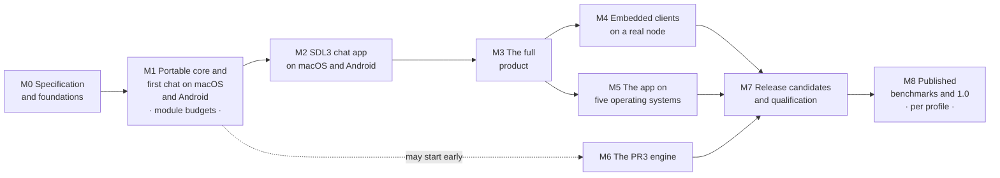

# Roadmap

Milestones are closed by their exit criteria in the [delivery plan](17-delivery-plan.md), never by dates. Two gates run through all of them: **tests** (every promised behaviour has a named test in the [test ledger](20-test-ledger.md), and a milestone closes only when its rows pass) and **performance** (from M1 on, no module closes over its budget and no change slows a measured module by more than 5%; inference is measured under MLPerf LoadGen, [part 15](15-benchmarks.md)). The order is [D-20](19-decisions-and-risks.md).

**Immediate objective (22 Nov 2026).** M0's foundations are built and pass on the development Mac: the build and its gates, the base library (also under CBMC), the test runner (also on the Android emulator), the freestanding links and `bench/c`'s sample format. What remains of M0 waits on the owner: the review of the specification and the vector files, the CI push, the physical phone, and the model files and licence for llama.cpp's baselines. In M1, canonical JSON (step 1.1, CORE-01) and the agent runtime (step 1.2, CORE-02) have passed on the Mac. Next unblocked: step 1.3, the trusted side (CORE-03).

## Why this order

1. **M0 first, because everything later is checked against it.** The byte formats become golden vectors written independently of the C code, the promised behaviours become named tests, and the benchmark harness and llama.cpp's baselines exist before any module is tuned. The base library (arenas, pools, the buddy heap, slices, checked arithmetic) lands here because every later line of C depends on it and on the gates in [part 14](14-build-and-quality.md).
2. **M1 proves the bet on the two devices the owner carries.** The core, JSON, the trusted side and the inference host are written, each replays its golden vectors byte for byte, and each meets its module budget ([BEN-03](17-delivery-plan.md)). The first chat runs on the llama.cpp backend, so PR3's host is measured against llama.cpp alone under LoadGen with the engine held constant. If the host adds measurable overhead there, the plan stops and says why.
3. **M2 brings the app forward.** A native app with no WebView is where memory, start-up and size gains are largest, and the owner asked for it ([D-02](19-decisions-and-risks.md)). One screen, the chat, on the same Mac and phone, with complex text and a screen reader working, before the rest of the product is built behind it.
4. **M3 is the product.** Encrypted stores, memory, tasks, documents, research, tools, continuity, and the node and client that pair two PR3 devices in both roles. It is the largest milestone and needs only M1's core and M2's shell.
5. **M4 and M5 can run side by side** after M3: the boards need M3's pairing and the node; the other operating systems need M3's services and M2's UI layer.
6. **M6, the engine, may start after M1** and runs in parallel with everything after it. It replaces llama.cpp in shipped builds only once it passes the same fixtures and beats the llama.cpp backend under LoadGen on the device, so nothing waits on it.
7. **M7 qualifies each profile; M8 publishes.** The full MLPerf matrix (Closed and Open, SingleStream and Offline) and the end-to-end dimensions on each profile's devices, labelled as [part 15](15-benchmarks.md#publishing-and-labelling) requires, then 1.0 shipped or held per profile.

## First steps of M0

| Steps | Work |
| --- | --- |
| 0.1 | SPEC-01: this specification |
| 0.2 | FND-01 build system, presets, warnings, sanitizers and checks; FND-03 the base library with its tests and model-checking harnesses |
| 0.3 | SPEC-02, SPEC-03: the test ledger and the golden vectors |
| 0.4 | FND-02, FND-04: the test runner on the Mac and the Android phone; the board contract and a freestanding link |
| 0.5 | BEN-01: the MLPerf harness (LoadGen, the C shim, the loopback SUT, smoke runs) |
| 0.6 | BEN-02: llama.cpp's baselines under LoadGen on both devices; the benchmark manifest hashed |

## Beyond M8

A PR3-owned speech path in place of the OS engines, more boards (RP2350, ESP32-S3), an NPU path where a device exposes a stable interface, and a smaller model qualified for the Pi 5's CPU alone.

---

[Back to the index](../README.md)
